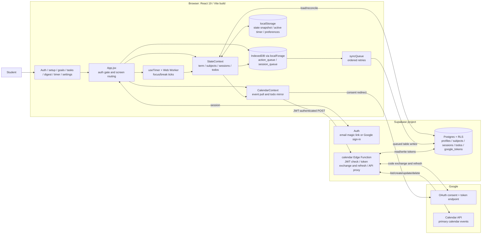

# MinTrack architecture

This diagram shows the runtime components in the current `src/` app. Google Calendar is optional; the rest of the app requires a Supabase session.

## Component boundaries

| Component | Responsibility | Main source |
| --- | --- | --- |
| `App.jsx` | Checks the Supabase session, chooses screens, handles subject and session actions, schedules queue sweeps | `src/App.jsx` |
| `StateContext` | Holds app state, reads local and remote records at startup, saves a browser snapshot, manages todo mutations | `src/contexts/StateContext.jsx` |
| `useTimer` and worker | Calculates focus/break phases locally; the worker sends one tick per second | `src/hooks/useTimer.js`, `public/worker.js` |
| `syncQueue` | Persists pending actions/sessions in IndexedDB and writes them to Supabase when online | `src/lib/syncQueue.js` |
| `CalendarContext` | Compares todos to mirrored events, requests event changes, polls visible calendar events every 30 seconds | `src/contexts/CalendarContext.jsx` |
| Calendar Edge Function | Validates the Supabase JWT, stores/refreshes Google tokens, calls Google Calendar | `supabase/functions/calendar/index.ts` |

The Vite output is a static browser app. The repository does not contain a custom application server for study data. The Calendar Edge Function is the server-side integration boundary.

## Data locations

| Location | Data |
| --- | --- |
| Browser `localStorage` | `mintrack_state` (term, subjects with sessions, todos, active timer, last update), deleted-session tombstones, theme and UI preferences |
| Browser IndexedDB | `MinTrack` action and session queues awaiting cloud sync |
| Supabase Postgres | `profiles` term dates; `subjects` goals; `sessions` logs; `todos` tasks and Google event IDs; `google_tokens` OAuth tokens |
| Google Calendar | Mirrored eligible scheduled todos as calendar events; native Google events are read back for the runway |

Subject progress shown in the UI is recalculated from non-discarded sessions. The `subjects.valid_hours` database column exists, but `syncQueue` does not update it when sessions sync. Active timer state, paused-time counters, and the daily-target snapshot are browser-local.

## External calls

| Origin | Destination | Purpose |
| --- | --- | --- |
| Browser | Supabase Auth | `getSession`, magic-link OTP, Google sign-in, sign-out |
| Browser | Supabase PostgREST | Load/reconcile `profiles`, `subjects`, `sessions`, `todos`; queued writes; delete Calendar token on disconnect |
| Browser | Google OAuth consent page | Optional Calendar authorization redirect |
| Browser | Supabase `POST /functions/v1/calendar` | `store-token`, `check-connection`, `get-events`, `create-event`, `update-event`, `delete-event` |
| Calendar Edge Function | Google OAuth token endpoint | Exchange authorization code and refresh access token |
| Calendar Edge Function | Google Calendar v3 primary-events endpoint | List, create, update and delete events |
| Browser | Google Fonts | Load typefaces referenced by `index.html` (asset request, not app data) |

Sources: `src/App.jsx`, `src/contexts/StateContext.jsx`, `src/contexts/CalendarContext.jsx`, `src/lib/syncQueue.js`, `src/lib/calendarClient.js`, `supabase/functions/calendar/index.ts`, `supabase/schema.sql`, `index.html`.
