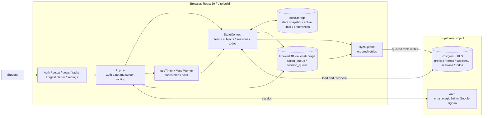

# MinTrack architecture

This diagram shows the runtime components in the current `src/` app. The app uses Supabase for sign-in and cloud data, with local browser storage for queued changes and preferences.

## Component boundaries

| Component | Responsibility | Main source |
| --- | --- | --- |
| `App.jsx` | Checks the Supabase session, chooses screens, handles subject and session actions | `src/App.jsx` |
| `StateContext` | Loads remote records, manages local app state, and coordinates todo mutations | `src/contexts/StateContext.jsx` |
| `useTimer` and worker | Calculates focus/break phases locally; the worker sends one tick per second | `src/hooks/useTimer.js`, `public/worker.js` |
| `syncQueue` | Persists pending operations in IndexedDB and writes them to Supabase when online | `src/lib/syncQueue.js` |

The Vite output is a static browser app. Study data is stored in Supabase, while the browser keeps timer state, preferences, and pending offline work.

## Data locations

| Location | Data |
| --- | --- |
| Browser `localStorage` | App snapshot, active timer, theme and UI preferences |
| Browser IndexedDB | `MinTrack` action and session queues awaiting cloud sync |
| Supabase Postgres | Profiles, terms, subjects, sessions and todos |

Subject progress shown in the UI is recalculated from non-discarded sessions. Active timer state and preferences remain browser-local.

## External calls

| Origin | Destination | Purpose |
| --- | --- | --- |
| Browser | Supabase Auth | Session management, magic-link sign-in, Google sign-in, sign-out |
| Browser | Supabase PostgREST | Load and save user-owned study data |
| Browser | Google Fonts | Load typefaces referenced by `index.html` |

Sources: `src/App.jsx`, `src/contexts/StateContext.jsx`, `src/lib/syncQueue.js`, `supabase/schema.sql`, `index.html`.
