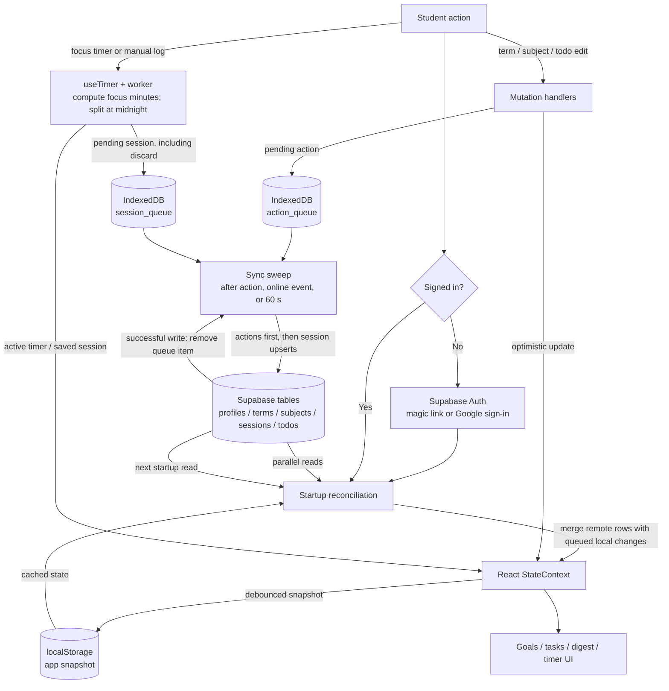

# MinTrack data flow

This diagram follows data through startup, edits, offline sync and focus sessions. Solid arrows are writes or requests; arrows pointing back into state are reads or responses.

## How to read the paths

1. **Startup:** Supabase Auth supplies the user session. `StateContext` fetches remote records and merges queued local changes into React state.
2. **Edits and logs:** The UI updates React state immediately. Subject, profile and todo writes enter `action_queue`; saved or discarded sessions enter `session_queue`.
3. **Cloud sync:** The queue is swept after user actions, when the browser comes online, and every 60 seconds. Successful items leave IndexedDB; failed items remain for a later attempt.
4. **Focus timer:** The worker emits ticks. `useTimer` calculates elapsed focus time in the browser; finishing opens a review step. Saving creates session rows and queues them. The active timer itself stays in the browser snapshot.

## API route map

| Route / SDK call | Caller | Purpose |
| --- | --- | --- |
| Supabase Auth SDK | Browser | User sign-in and session token |
| Supabase table SDK | Browser | Read and write profiles, terms, subjects, sessions and todos |
| Google Fonts | Browser | Load typefaces referenced by `index.html` |

Smart task date recognition uses `chrono-node` locally and makes no parsing API call. Google sign-in uses Supabase Auth.

Sources: `src/components/Auth.jsx`, `src/contexts/StateContext.jsx`, `src/App.jsx`, `src/hooks/useTimer.js`, `src/lib/syncQueue.js`.
