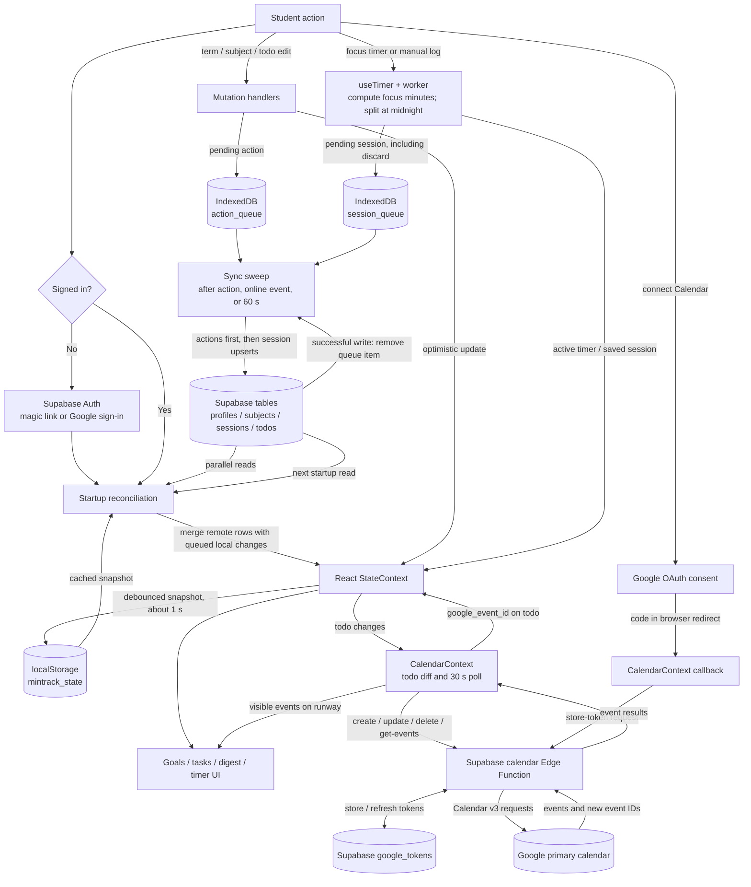

# MinTrack data flow

This diagram follows the data through startup, edits, offline sync, focus sessions, and the optional Calendar connection. Solid arrows are writes or requests; arrows pointing back into state are reads/responses.

## How to read the paths

1. **Startup:** Supabase Auth supplies the user session. `StateContext` reads the browser snapshot and fetches the user's remote records, then merges queued local-only sessions and todos into React state. Deleted-session tombstones keep pending deletions from reappearing.
2. **Edits and logs:** The UI changes React state immediately. State is copied to `localStorage` after a one-second debounce. Subject, profile and todo writes enter `action_queue`; saved or discarded sessions enter `session_queue`.
3. **Cloud sync:** The queue is swept after many user actions (roughly 600 ms debounce), when the browser comes online, and every 60 seconds. Actions are processed before sessions. Successful items leave IndexedDB; failed items normally remain for a later attempt. A session with a missing subject and no pending subject insert is dropped. Session rows are upserted by ID.
4. **Focus timer:** The worker only emits ticks. `useTimer` calculates elapsed focus time in the browser; finishing opens a review step. Saving creates session rows and queues them. The active timer itself stays in the browser snapshot.
5. **Calendar:** Connecting redirects to Google consent, then the Edge Function exchanges the code and stores tokens in `google_tokens`. For eligible future scheduled todos, the browser asks the Edge Function to mirror all-day events. The function calls Google Calendar with server-held credentials. Calendar events for the visible runway are fetched via the same function every 30 seconds while connected.

## API route map

| Route / SDK call | Caller | Payload or result |
| --- | --- | --- |
| Supabase Auth SDK | Browser | User sign-in and session token |
| Supabase table SDK | Browser | `profiles`, `subjects`, `sessions`, `todos`; direct `google_tokens` delete on disconnect |
| `POST /functions/v1/calendar` | Browser | Action plus parameters, authorized with Supabase bearer token |
| `POST https://oauth2.googleapis.com/token` | Edge Function | Calendar authorization-code exchange or token refresh |
| `GET/POST/PUT/DELETE https://www.googleapis.com/calendar/v3/calendars/primary/events` | Edge Function | Calendar events (GET is limited to 50 results per request in current code) |

The Google sign-in on the app's login screen and the optional Google Calendar consent are separate authorization flows. Smart task date recognition uses `chrono-node` locally and makes no parsing API call.

Sources: `src/components/Auth.jsx`, `src/contexts/StateContext.jsx`, `src/App.jsx`, `src/hooks/useTimer.js`, `src/lib/syncQueue.js`, `src/contexts/CalendarContext.jsx`, `src/lib/calendarClient.js`, `supabase/functions/calendar/index.ts`.
